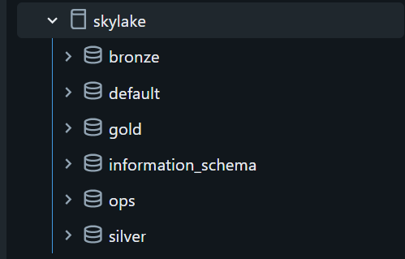
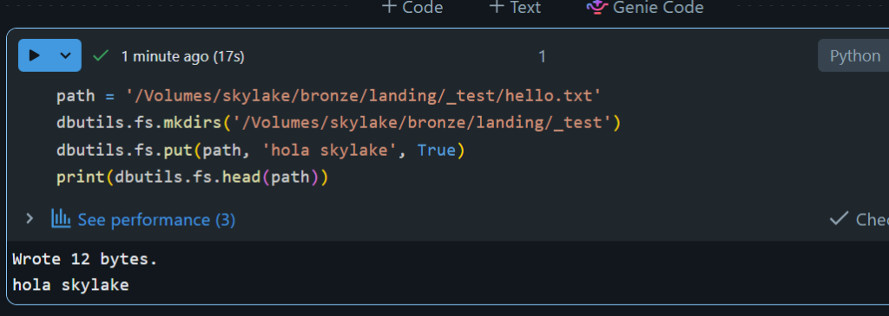

# Evidencia: SKY-004 (Catálogo, schemas y Volume)

- **Fecha:** 2026-11-05
- **Ticket:** `SKY-004` (#4)
- **Estado:** Completado

## 1. Creación de Catálogo, Schemas y Volume en SQL Editor

Se ejecutó `scripts/00_setup_catalog.sql` en el **Serverless Starter Warehouse**:

```sql
CREATE CATALOG IF NOT EXISTS skylake COMMENT 'Proyecto SkyLake: trafico aereo';
CREATE SCHEMA IF NOT EXISTS skylake.bronze COMMENT 'Datos crudos';
CREATE SCHEMA IF NOT EXISTS skylake.silver COMMENT 'Datos limpios y tipados';
CREATE SCHEMA IF NOT EXISTS skylake.gold   COMMENT 'Modelo analitico';
CREATE SCHEMA IF NOT EXISTS skylake.ops    COMMENT 'Observabilidad del pipeline';
CREATE VOLUME IF NOT EXISTS skylake.bronze.landing COMMENT 'Archivos crudos de OpenSky';
```

### Evidencia visual del Catálogo y Schemas


---

## 2. Prueba de escritura y lectura en el Volume (`skylake.bronze.landing`)

Ejecutado desde un Notebook Serverless:

```python
path = '/Volumes/skylake/bronze/landing/_test/hello.txt'
dbutils.fs.mkdirs('/Volumes/skylake/bronze/landing/_test')
dbutils.fs.put(path, 'hola skylake', True)
print(dbutils.fs.head(path))
```

**Salida:**
```text
Wrote 12 bytes.
hola skylake
```

### Evidencia visual de lectura/escritura en el Volume

